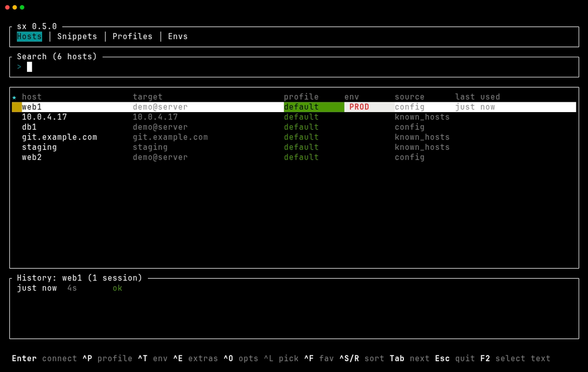
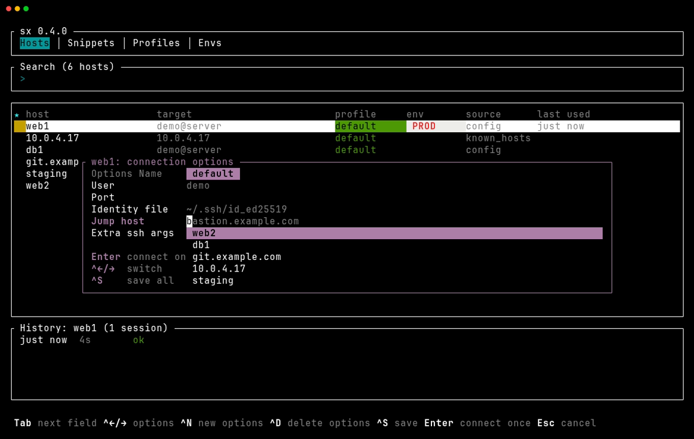
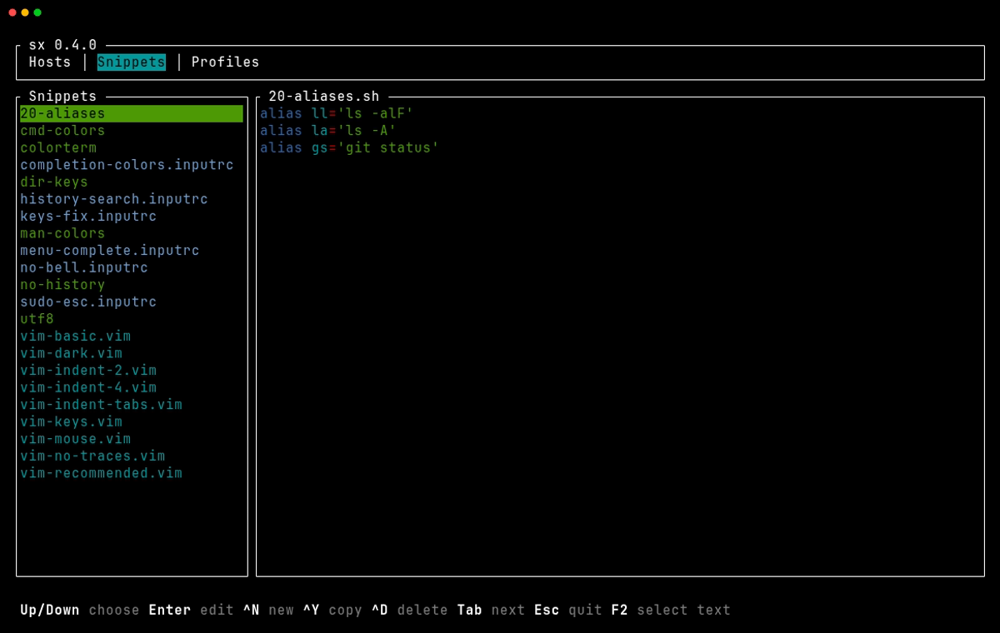
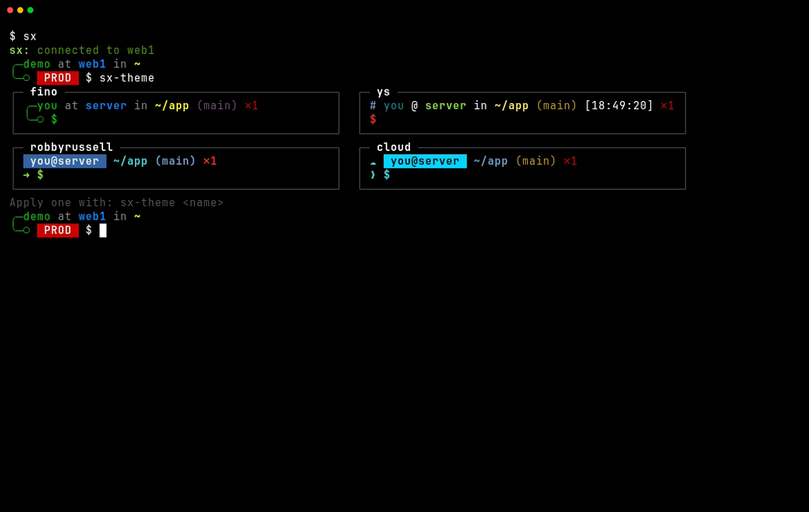

# sx

Use your own shell prompt and aliases on any server.

`sx` is a wrapper around `ssh`. Use it like `ssh`: `sx user@host`.
The remote bash then starts with your prompt and aliases.

Nothing is installed or written on the server, and nothing is left behind when the session ends.

Details are under [How it works](#how-it-works).


## Contents

- [What you get](#what-you-get)
- [Install](#install)
- [Usage](#usage)
- [How it works](#how-it-works)
- [TUI](#tui)
- [Configurations](#configurations)
- [Snippet kinds](#snippet-kinds)
- [Prompt themes](#prompt-themes)
- [Snippet presets](#snippet-presets)
- [Commands on the server](#commands-on-the-server)
- [Terminal integration](#terminal-integration)
- [Limitations](#limitations)
- [Build](#build)
- [License](#license)

## What you get

- Your prompt and aliases on every server, from small snippet files you keep locally.
- Your `vim`, `tmux` and readline (`inputrc`) settings on the server as well.
- A terminal UI to browse hosts, edit snippets and see recent sessions for each host.
- Built-in [snippet presets](#snippet-presets) and [prompt themes](#prompt-themes), ready to turn on. You can edit them or write your own.
- Profiles that group snippets and a prompt, assigned per host.
- The same arguments as `ssh`.

Quick start:

```sh
sx init                 # create the snippet presets and the default profile
sx user@host            # log in with your rc
sx                      # or open the TUI
```

Needs `ssh` on your `PATH` and bash on the server, see [Install](#install) and [Limitations](#limitations).

## Install

Linux and macOS:

```sh
curl --proto '=https' --tlsv1.2 -LsSf https://github.com/vittee/sx/releases/latest/download/sx-ssh-installer.sh | sh
```

Windows (PowerShell):

```powershell
powershell -ExecutionPolicy Bypass -c "irm https://github.com/vittee/sx/releases/latest/download/sx-ssh-installer.ps1 | iex"
```

Or download an archive from the [releases page](https://github.com/vittee/sx/releases),
or build it yourself, see [Build](#build).

For shell completion, see [Usage](#usage).

`sx` runs the `ssh` it finds on your `PATH`.
Linux and macOS ship it.
On Windows, turn on the optional feature "OpenSSH Client" (Settings, Apps, Optional features).

## Usage

```sh
sx                                                                   # open the TUI
sx [ssh args] <host>                                                 # like ssh, with your rc injected
sx <host> --options <name>                                           # use the options named <name>, saved for the host (Ctrl-O in the TUI)
sx --dry-run [ssh args] <host>                                       # print the ssh command, do not run it
sx init [--presets]                                                  # create the snippet presets and the default profile, --presets adds the presets that are missing, switched off, and updates the older ones
sx completions <bash|zsh|fish|powershell|nushell>                    # print a completion script
sx completions --install [bash|zsh|fish|powershell|nushell] [--yes]  # set up shell completion (asks first)
sx --version                                                         # print the sx version (ssh's -V shows the ssh one)
```

## How it works

`sx` runs `ssh` with two extra options:

- `-o RequestTTY=force`
- `-o RemoteCommand=...` carries your rc, gzipped and base64-encoded, inside the command.<br>
  The command decodes it and starts `bash --rcfile <(...)`.<br>
  The server's own `~/.bashrc` is sourced first, then yours.

While you are logged in, other users on the server can see the command in the process list,
so do not put secrets in snippets.

## TUI

- [Navigation](#navigation)
- [Hosts page](#hosts-page)
- [Snippets page](#snippets-page)
- [Profiles page](#profiles-page)

### Navigation

Keyboard and mouse both work (click, double-click, wheel).

While the mouse is captured, the terminal cannot select text.<br>
Use `F2` to toggle mouse capture.
Most terminals also let you select while holding `Shift`.

If the wheel or trackpad scrolls the wrong way (natural scrolling on macOS, for example)<br>
Enable `invert_scroll`

```toml
# config.toml

invert_scroll = true
```

### Hosts page

The Hosts page is where you start. It lists the servers you can connect to.

Type to search or pick one from the list, and press `Enter` to get a shell with your prompt and aliases.

The list comes from `~/.ssh/config` and `~/.ssh/known_hosts`.

The `source` column shows which one a host came from.

You can also connect to a host by typing it directly in the search box.

Typing `root@web` filters the list on `web` and connects to the selected host as `root`, for this
connection only.



#### Keys
- `Ctrl-P`, or click on the profile column.<br>The arrow keys only move in the list, so a stray key cannot change a profile.
- `Ctrl-F`, or click on the star, marks a favorite.
- `Ctrl-E` picks extra snippets for the selected host on top of its profile's.
  The profile column then reads `default+2`.
- `Ctrl-O` edits the connection options of the selected host.
  A host can keep several named options, such as `root` or `deploy via bastion`, and the form lists its keys.
  `Ctrl-K` picks the identity file from the keys in `~/.ssh` and the jump host from the other hosts.
  Hosts that other saved options already use as a jump host come first, then names like `bastion`, `jump` or `gateway`.
- `Ctrl-L` picks one of the host's named options and connects with them.
- `Ctrl-S` cycles the sort column and `Ctrl-R` reverses it, or click a column header (click again to reverse).



When the terminal is tall enough,
a history pane under the list shows the last five sessions of the selected host:
when, how long, how it ended.

### Snippets page

The Snippets page is where you create and edit snippets: the small files `sx` sends to the server, such as aliases, vim and tmux settings, key bindings and prompts.

The file name decides what a snippet is, see [Snippet kinds](#snippet-kinds).

`sx init` creates ready-made ones, see [Snippet presets](#snippet-presets).



The editor colors shell, vim and inputrc syntax.<br>
A snippet that sets `PS1`, and every `.prompt` snippet, also gets a prompt preview underneath.

### Profiles page

Each profile has its own prompt and snippets.


#### Keys
- `Ctrl-N` creates a profile
- `Ctrl-Y` copies the selected profile
- `Ctrl-D` deletes it
- `Ctrl-G` makes it the default
- Clicking `Window title` or `Prompt marks` in the Terminal box turns it on or off for the profile, see [Terminal integration](#terminal-integration)
- `Ctrl-E` edits the selected prompt theme

## Configurations

`sx` keeps its files in `$SX_HOME`, or `~/.config/sx` when that is not set:

- `config.toml` holds the profiles (snippets and prompt theme), the default profile,
  each host's profile, extra snippets and connection options, favorites and last-used times.  
- `history.tsv` has one line per session (time, host, seconds, outcome), trimmed to the newest 1000.
- `snippets/<name>.sh` holds the rc pieces.<br>
  A host gets its profile's snippets plus its own extras, joined in name order,
  so names like `10-prompt` and `20-aliases` control the order.<br>
  A snippet in both places is sent once.

A snippet can start with a front matter block, which `sx` never sends to the server:

```
---
description: Colored ls and a few aliases
---
alias ll='ls -l'
```

Profiles shows the `description` of the snippet under the cursor, on the bottom border of the Snippets box.<br>
Other keys are ignored for now.<br>
Without a front matter block, a first line that is a comment (`#`, or `"` in `.vim` files) is the description.

The prompt theme goes after the snippets, so choosing one overrides any `PS1` a snippet sets.
A fresh setup starts with the `fino` theme.

## Snippet kinds

A `.vim`, `.tmux` or `.inputrc` snippet is wrapped in shell that hands the text to the program
without writing a file on the server.

| Name | Effect on the server | Built-in |
|---|---|---|
| `x.sh` (or just `x`) | Sourced as shell | [Shell presets](#shell-presets) |
| `x.vim` | `vim` and `nvim` run with `-u` on this config, through process substitution.<br> All enabled `.vim` snippets are joined in name order, and a later name wins when two set the same option, so they work as layers | [Vim presets](#vim-presets) |
| `x.tmux` | `tmux` runs with `-f` on this config, all enabled `.tmux` snippets joined in name order | |
| `x.inputrc` | Changes the key bindings and settings of bash's line editor (readline) | [inputrc presets](#inputrc-presets) |
| `x.prompt` | Prompt theme you can pick in Profiles | [Prompt themes](#prompt-themes) |

## Prompt themes

### Built-in themes

Eleven built-in themes are based on [oh-my-zsh](https://ohmyz.sh/) themes.

Press `Ctrl-E` on one in Profiles to edit it.<br>
This saves a copy as a `.prompt` snippet, such as `fino.prompt`, and switches the profile to it.

### Your own themes

A theme of your own is a `.prompt` snippet. Create one in the Snippets page, or edit a built-in theme to get a copy. It then shows in the theme list in Profiles, where you pick it like a built-in one.

### Try a theme on the server

Run `sx-theme <name>` on the server to try a theme without reconnecting, see [`sx-theme`](#sx-theme-sxt).

## Snippet presets

A snippet preset is a ready-made snippet that `sx init` creates for you, all off. Turn on the ones you want in Profiles.

Each preset starts with front matter that holds its `description` and its `version`, written `major.minor` such as `1.0`.<br>
For a setup made before they existed, `sx init --presets` adds the presets that are missing.<br>
It also replaces a preset whose `version` is older than the built-in one, so fixes reach you, and your edits to that preset are lost.<br>
A copy with no `version`, a `version` that is not in the `major.minor` form, or a newer `version`, is left alone, so write your own snippets under another name, or delete the preset file to get the built-in one back.

### Shell presets

| Preset | What it gives you |
|---|---|
| `20-aliases` | `ll`, `la` and `gs` for `ls -alF`, `ls -A` and `git status`.<br> The default profile turns it on |
| `colorterm` | Sets `COLORTERM=truecolor`, so `vim` and `less` use 24-bit color. Turn it on only if your terminal supports it (Windows Terminal, iTerm2, kitty and WezTerm do) |
| `no-history` | `unset HISTFILE`, so this shell writes no history file. Up-arrow history still works |
| `man-colors` | Colored man pages, and `less` keeps colors and ignores case in searches |
| `cmd-colors` | Color for `ls`, `grep` and `diff`, only where the server supports it |
| `dir-keys` | Directory navigation<br> `Alt-Up` goes to the parent directory<br> `Alt-Left`<br> `Alt-Right` go back and forward through the directories you visited. <br> Please note that using this clears the command you were typing, use `Ctrl-Y` to paste it back |
| `utf8` | Sets a UTF-8 locale when the shell is not in one and the server has one, so box drawing and accents show |

### Inputrc presets

`.inputrc` presets change how bash's line editor (readline) behaves: key bindings and settings for typing, history and Tab completion.

| Preset | What it gives you |
|---|---|
| `completion-colors.inputrc` | Tab completion lists are colored with your `LS_COLORS`, and the part you typed is highlighted.<br> Turn on `cmd-colors` too if the server has no `LS_COLORS` |
| `history-search.inputrc` | Up and Down search the history for what you typed so far |
| `keys-fix.inputrc` | `Home`, `End`, `Delete` and `Ctrl-Left/Right` work on every server |
| `menu-complete.inputrc` | `Tab` cycles through the matches and `Shift-Tab` goes back |
| `no-bell.inputrc` | No beep or window flash when a completion fails or the cursor hits an edge |
| `sudo-esc.inputrc` | `Esc` twice puts `sudo` in front of the command line (emacs keys only, since in vi mode `Esc` leaves insert mode). It also shortens the wait for a longer key sequence from 500 to 100 ms (`keyseq-timeout`), so `Esc Esc` does not lag |

### Vim presets

| Preset | What it sets |
|---|---|
| `vim-basic` | Syntax, filetype indent, line numbers, ruler, incremental and highlighted search |
| `vim-recommended` | Everything in `vim-basic`, plus smart-case search, scroll margin, whitespace markers, split directions, `j`/`k` on screen lines, Enter clears the highlight |
| `vim-indent-2`, `vim-indent-4` | Spaces for indenting |
| `vim-indent-tabs` | Real tabs, 8 wide |
| `vim-mouse` | Mouse and system clipboard |
| `vim-keys` | Space as leader, `jk` for Esc, `Ctrl-h/j/k/l` between windows, a few leader mappings |
| `vim-dark` | Dark background and the `desert` color scheme |
| `vim-no-traces` | No swap, backup, undo or viminfo files on the server |

## Commands on the server

### `sx-theme` (`sxt`)



To try another theme without reconnecting, run `sx-theme <name>` on the server.

Running `sx-theme` without an argument previews every theme.

`sx-theme -l` lists the names.

A theme you pick lasts until you exit.

### `clip`

`clip` on the server puts text in the clipboard of the machine you are sitting at.

Use `clip some text`, or pipe into it: `cat ~/.ssh/id_ed25519.pub | clip`.

Inside tmux, add `set -g set-clipboard on` to your tmux config.

### `sx-info`

`sx-info` shows what `sx` set up in this shell: the profile, prompt theme, snippets, host, bash version and size sent.

### `sx-sudo`

`sx-sudo [user]` opens a shell as that user, root by default, with your setup.

**Why?**

After `sudo -i` you are in root's own shell, with none of your prompt and aliases.

### `sx-tmux`

**Why?**

A window in plain `tmux` starts a bash that reads only the server's own files, so it has none of your prompt, aliases or `sx-*` commands.

Use `sx-tmux` instead of `tmux` when you want your setup in every window.

It takes the same arguments as `tmux`, for example `sx-tmux new -s work` or `sx-tmux attach`.

> A tmux server that is already running keeps its own shells, so quit it first (`tmux kill-server`).

## Terminal integration

`sx` talks to your terminal in two ways, both on by default: the window title and the prompt marks.<br>
A profile can turn each off, with a click in the Terminal box on the Profiles page, or in `config.toml`:

```toml
[profiles.default]
title = false   # no window title
marks = false   # no prompt marks
```

The `[sx]` title on your own machine, while the TUI is open, is not affected.

### Window and tab title

`sx` puts `[sx]` in the title of your terminal window or tab, so you can tell which one it is running in.

### Prompt marks

The server also marks where each prompt, command and output starts and ends.

A terminal that understands the marks can jump from one prompt to the next, select the output of one command,
and show failed commands.

The output and exit status marks need bash 4.4 or newer.

## Limitations

- The server must run bash. zsh and fish rc files are not supported.
- If bash, `base64 -d` or `gunzip` is missing on the server,
  you get the plain login shell and a one-line `sx:` message that gives the reason.
- Payloads over about 24 KB (encoded) trigger a warning.
- Hosts that appear only as hashed entries in `~/.ssh/known_hosts` are not listed.<br>
  When `HashKnownHosts` is on (the default on some systems), ssh stores a host as `|1|salt|hash`
  instead of its name, and a hash cannot be turned back into a name.<br>
  Hosts from `~/.ssh/config` are always listed.<br>
  To reach a hashed host, type its name in the search box and press Enter,
  or add a `Host` entry for it in `~/.ssh/config`.

## Build

```sh
cargo build --release   # binary: target/release/sx
cargo test
```

## License

[MIT](LICENSE)
