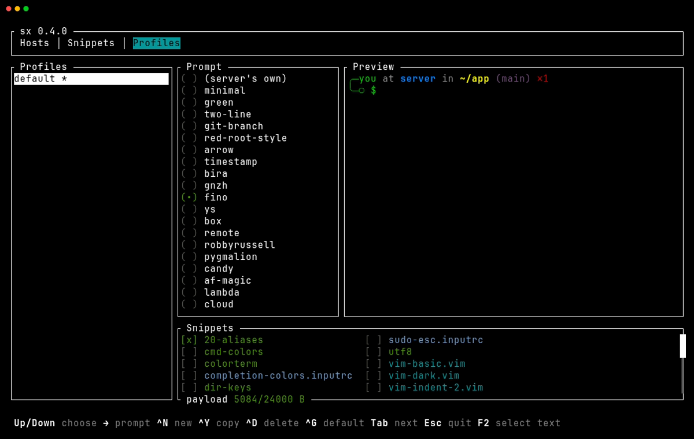
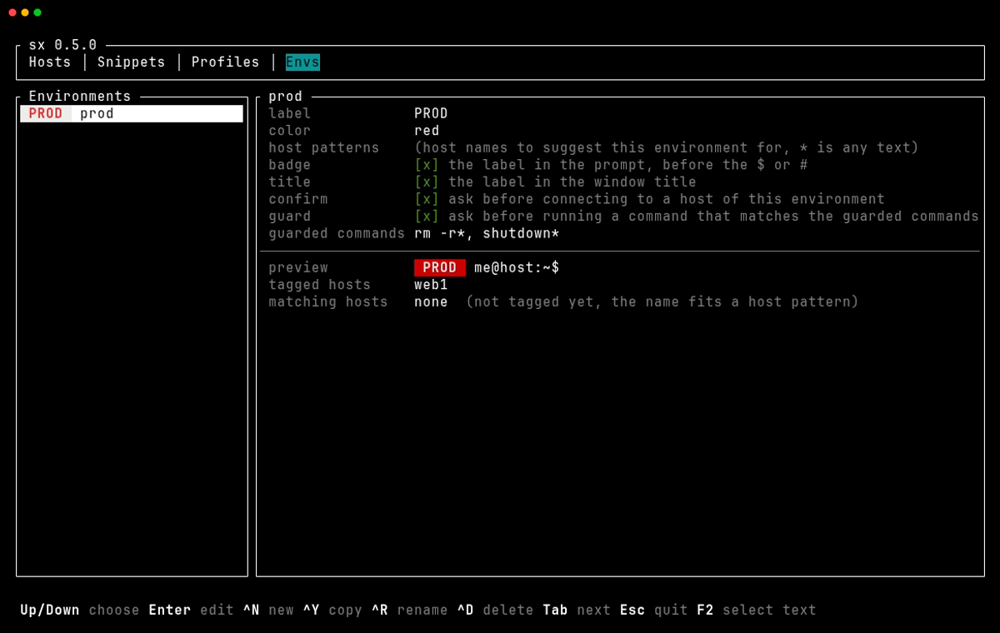

# sx

Use your own shell prompt and aliases on any server.

`sx` is a wrapper around `ssh`. Use it like `ssh`: `sx user@host`.
The remote bash then starts with your prompt and aliases.

`sx` installs and writes nothing on the server, and leaves nothing behind when the session ends.


## Contents

- [What you get](#what-you-get)
- [Install](#install)
- [Usage](#usage)
- [How it works](#how-it-works)
- [TUI](#tui)
- [Configurations](#configurations)
- [Snippet kinds](#snippet-kinds)
- [Front matter](#front-matter)
- [Prompt themes](#prompt-themes)
- [Snippet presets](#snippet-presets)
- [Commands on the server](#commands-on-the-server)
- [Environments](#environments)
- [Terminal integration](#terminal-integration)
- [Limitations](#limitations)
- [Build](#build)
- [License](#license)

## What you get

- Your prompt and aliases on every server.
- Your `vim`, `tmux` and readline (`inputrc`) settings on the server too.
- A terminal UI.
- Built-in snippets and prompt themes. Edit them or write your own.
- Profiles that group snippets and a prompt, assigned per host.
- Environments that tag a host with a badge, a confirmation before you connect, and a guard for commands.
- The same arguments as `ssh`.

Quick start:

```sh
sx init                 # create the snippet presets and the default profile
sx user@host            # log in with your rc
sx                      # or open the TUI
```

`sx` needs `ssh` on your `PATH` and bash on the server.

## Install

Linux and macOS:

```sh
curl --proto '=https' --tlsv1.2 -LsSf https://github.com/vittee/sx/releases/latest/download/sx-ssh-installer.sh | sh
```

Windows (PowerShell):

```powershell
powershell -ExecutionPolicy Bypass -c "irm https://github.com/vittee/sx/releases/latest/download/sx-ssh-installer.ps1 | iex"
```

You can also download an archive from the [releases page](https://github.com/vittee/sx/releases), or build `sx` yourself.

`sx` runs the `ssh` it finds on your `PATH`.
Linux and macOS ship it.
On Windows, turn on the optional feature "OpenSSH Client" (Settings, Apps, Optional features).

## Usage

```sh
sx                                                                   # open the TUI
sx [ssh args] <host>                                                 # like ssh, with your rc injected
sx <host> --options <name>                                           # use the options named <name>, saved for the host (Ctrl-O in the TUI)
sx --dry-run [ssh args] <host>                                       # print the ssh command, do not run it
sx init [--presets]                                                  # create the snippet presets and the default profile, --presets adds the missing presets (off) and updates the older ones
sx completions <bash|zsh|fish|powershell|nushell>                    # print a completion script
sx completions --install [bash|zsh|fish|powershell|nushell] [--yes]  # set up shell completion (asks first)
sx --version                                                         # print the sx version (ssh's -V shows the ssh one)
```

## How it works

`sx` runs `ssh` with two extra options:

- `-o RequestTTY=force`
- `-o RemoteCommand=...` carries your rc, gzipped and base64-encoded, inside the command.<br>
  The command decodes it and starts `bash --rcfile <(...)`.<br>
  The shell reads the server's own `~/.bashrc` first, then yours.

While you are logged in, other users on the server can see the command in the process list,
so do not put secrets in snippets.

## TUI

- [Navigation](#navigation)
- [Hosts page](#hosts-page)
- [Snippets page](#snippets-page)
- [Profiles page](#profiles-page)
- [Envs page](#envs-page)

### Navigation

Keyboard and mouse both work.

While `sx` captures the mouse, the terminal cannot select text.
`F2` toggles mouse capture.
Most terminals also select text while you hold `Shift`.

If the wheel or trackpad scrolls the wrong way, set `invert_scroll`:

```toml
# config.toml

invert_scroll = true
```

### Hosts page

The Hosts page lists the servers you can connect to.
It reads them from `~/.ssh/config` and `~/.ssh/known_hosts`, and the `source` column shows which one a host came from.

Type to filter the list, and press `Enter` to connect to the selected host.
Type `user@web` to filter on `web` and connect as `user`.
You can also type a host that is not in the list, and connect to it directly.


#### Keys

- `Up` and `Down` move in the list.
- `Ctrl-P`, or a click on the profile column, picks a profile.
- `Ctrl-F`, or a click on the star, marks a favorite.
- `Ctrl-T`, or a click on the `env` column, tags the host with an environment.
- `Ctrl-E` picks the extra snippets.
- `Ctrl-O` edits the connection options.
- `Ctrl-L` picks one of the host's named options and connects with them.
- `Ctrl-S` cycles the sort column.
- `Ctrl-R` reverses the sort order.


In the connection options form, `Ctrl-Left` and `Ctrl-Right` switch between the named options of the host.

When the terminal is tall enough, a history pane shows under the list.
It shows the last five sessions of the selected host: when, how long, how it ended.

### Snippets page

The Snippets page is where you create and edit snippets.
A snippet is a small file that `sx` sends to the server, such as aliases, vim and tmux settings, key bindings and prompts.


The editor colors shell, vim and inputrc syntax.
A snippet that sets `PS1`, and every `.prompt` snippet, also gets a prompt preview underneath.

`Ctrl-S` saves the snippet and keeps the editor open.
`Esc` leaves the editor.
When the snippet has changes that you did not save, `sx` asks whether to save them before it leaves the editor, switches page or quits.

### Profiles page

Each profile has its own prompt and snippets.



#### Keys

- `Ctrl-N` creates a profile.
- `Ctrl-Y` copies the selected profile.
- `Ctrl-D` deletes it.
- `Ctrl-G` makes it the default.
- `Ctrl-E` edits the selected prompt theme.

### Envs page

The Envs page is where you make and edit environments.
The host name patterns of an environment suggest its tag in the host list.



#### Keys

- `Ctrl-N` creates an environment.
- `Ctrl-Y` copies the selected environment.
- `Ctrl-R` renames it.
- `Ctrl-D` deletes it.

## Configurations

`sx` keeps its files in `$SX_HOME`, or `~/.config/sx` when it is not set:

- `config.toml` holds the profiles (snippets and prompt theme), the default profile, each host's profile,
  extra snippets, connection options, favorites and last-used times.
- `history.tsv` has one line per session (time, host, seconds, outcome). `sx` keeps the newest 1000.
- `snippets/` holds the snippets.

A host gets its profile's snippets, minus the ones it leaves out, plus its own extras.
`sx` sends each one once, in name order, so the file names control the order.
The prompt theme comes after the snippets, so it overrides any `PS1` that a snippet sets.
A new setup uses the `fino` theme.

## Snippet kinds

The file extension sets the kind of a snippet.
`sx` passes `.vim`, `.tmux` and `.inputrc` snippets to the program through process substitution, so nothing is written on the server.

| Name | Effect on the server |
|---|---|
| `x.sh` (or just `x`) | Sourced as shell |
| `x.vim` | `vim` and `nvim` run with `-u` on this text. Enabled `.vim` snippets join in name order, and a later name wins |
| `x.tmux` | `tmux` runs with `-f` on this text. Enabled `.tmux` snippets join in name order |
| `x.inputrc` | Sets key bindings and settings of readline, the line editor of bash |
| `x.prompt` | A prompt theme |

## Front matter

A snippet can start with a front matter block.
`sx` reads it and never sends it to the server.
The block starts and ends with a line of three dashes, and each line in it is `key: value`:

```
---
description: Colored ls and a few aliases
---
alias ll='ls -l'
```

| Key | Snippets | Value |
|---|---|---|
| [`description`](#description) | All | A short text |
| [`version`](#version) | Built-in presets | `major.minor` |
| [`nerd-font`](#nerd-font) | `.prompt` | Boolean, optional |

`sx` ignores other keys.

### `description`

Profiles shows it on the bottom border of the Snippets box.
Without a front matter block, the description is the first line, when it is a comment (`#`, or `"` in `.vim` files).

### `version`

`sx init --presets` adds the presets that are missing.
It replaces a preset whose `version` is older than the built-in one, so fixes reach you but you lose your edits.
It leaves a copy alone when the copy has no `version`, a `version` that is not `major.minor`, or a newer `version`.

Write your own snippets under another name.
To get a built-in preset back, delete its file.

### `nerd-font`

A boolean: `yes` or `no`.
Use `yes` when the theme needs a Nerd Font, and Profiles notes it in the preview.

## Prompt themes

### Built-in themes

The built-in themes come from [oh-my-zsh](https://ohmyz.sh/) and [oh-my-posh](https://ohmyposh.dev/docs/themes) themes.
Most need a [Nerd Font](https://www.nerdfonts.com/) for their arrows and icons, and a terminal with truecolor for their `#rrggbb` colors.
The preview in Profiles says which ones a theme needs.

### Your own themes

A theme of your own is a `.prompt` snippet.
Create one in the Snippets page, or edit a built-in theme to get a copy.
It then shows in the theme list in Profiles.

### Switch theme on the server

Run `sx-theme <name>` on the server to try a theme without reconnecting.
It offers the profile's own theme and the themes you ticked for the profile in Profiles.

### Job count

When the shell has background jobs or stopped jobs, the prompt shows a down arrow and their number.
This works with every theme, and it has no switch.
The number counts both kinds, as `%j` does in zsh.
It goes away when no job is left.

The count sits right before the prompt symbol, next to the badge of an environment.
A shell that did not get it from `sx`, for example the one that `sudo -i` starts, shows nothing.

## Snippet presets

`sx init` creates the presets.
All of them are off. Enable the ones you want in Profiles.

### Shell presets

| Preset | What it gives you |
|---|---|
| `20-aliases` | `ll`, `la` and `gs` for `ls -alF`, `ls -A` and `git status`.<br> The default profile enables it |
| `colorterm` | Sets `COLORTERM=truecolor`, so `vim` and `less` use 24-bit color.<br> Enable it only if your terminal supports it (Windows Terminal, iTerm2, kitty and WezTerm do) |
| `no-history` | `unset HISTFILE`, so this shell writes no history file. Up-arrow history still works |
| `man-colors` | Colored man pages. `less` keeps colors and ignores case in searches |
| `cmd-colors` | Color for `ls`, `grep` and `diff`, only where the server supports it |
| `dir-keys` | `Alt-Up` goes to the parent directory.<br> `Alt-Left` and `Alt-Right` go back and forward through the directories you visited.<br> These keys clear the command you were typing. `Ctrl-Y` pastes it back |
| `utf8` | Sets a UTF-8 locale when the shell is not in one and the server has one. Box drawing and accents then show |

### Inputrc presets

`.inputrc` presets set readline key bindings and settings for typing, history and Tab completion.

| Preset | What it gives you |
|---|---|
| `completion-colors.inputrc` | Tab completion lists use the colors of your `LS_COLORS` and highlight the part you typed.<br> Enable `cmd-colors` too if the server has no `LS_COLORS` |
| `history-search.inputrc` | Up and Down search the history for what you typed so far |
| `keys-fix.inputrc` | `Home`, `End`, `Delete` and `Ctrl-Left/Right` work on every server |
| `menu-complete.inputrc` | `Tab` cycles through the matches and `Shift-Tab` goes back |
| `no-bell.inputrc` | No beep or window flash when a completion fails or the cursor hits an edge |
| `sudo-esc.inputrc` | `Esc` twice puts `sudo` in front of the command line (emacs keys only: in vi mode `Esc` leaves insert mode).<br> It also cuts the wait for a key sequence from 500 to 100 ms (`keyseq-timeout`), so `Esc Esc` does not lag |

### Vim presets

| Preset | What it sets |
|---|---|
| `vim-basic` | Syntax, filetype indent, line numbers, ruler, incremental and highlighted search |
| `vim-recommended` | Everything in `vim-basic`, plus smart-case search, scroll margin, whitespace markers, split directions and `j`/`k` on screen lines.<br> `Enter` clears the highlight |
| `vim-indent-2`, `vim-indent-4` | Spaces for indenting |
| `vim-indent-tabs` | Real tabs, 8 wide |
| `vim-mouse` | Mouse and system clipboard |
| `vim-keys` | Space as leader, `jk` for Esc, `Ctrl-h/j/k/l` between windows, a few leader mappings |
| `vim-dark` | Dark background and the `desert` color scheme |
| `vim-no-traces` | No swap, backup, undo or viminfo files on the server |

## Commands on the server

### `sx-theme` (`sxt`)


`sx-theme <name>` tries another theme without reconnecting.

`sx-theme` with no argument previews the themes it offers.
These are the profile's own theme and the ones you tick with `Space` in the Prompt box of the Profiles page.
`sx` sends no other theme, so each one you tick makes the payload bigger.
A profile with no ticked theme offers only its own.

`sx-theme -l` lists the names.
A theme you pick lasts until you exit.

### `clip`

`clip` puts text in the clipboard of the machine you are sitting at.
Pass the text as arguments, or pipe it in: `cat ~/.ssh/id_ed25519.pub | clip`.

Inside tmux, add `set -g set-clipboard on` to your tmux config.

### `sx-info`

`sx-info` shows:

- the `sx` version and the server
- the environment and its guarded commands, when it has a guard
- what `sx` set up in this shell: the profile, the prompt theme and the snippets
- the bash version
- the payload size, which is the compressed setup that `sx` sent

`sx-info` colors the names when the output is a terminal, unless `NO_COLOR` is set.

### `sx-sudo`

`sx-sudo [user]` opens a shell as that user, root by default, with your setup.

After `sudo -i` you are in root's own shell, with none of your prompt and aliases.

### `sx-tmux`

`sx-tmux` takes the same arguments as `tmux`, for example `sx-tmux new -s work` or `sx-tmux attach`.

A window in plain `tmux` starts a bash that reads only the server's own files.
It has none of your prompt, aliases or `sx-*` commands.
Use `sx-tmux` instead of `tmux` to get your setup in every window.

> A tmux server that is already running keeps its own shells, so quit it first (`tmux kill-server`).

### `sx-zsh`

`sx-zsh` starts zsh with your prompt, translated from bash.

**What works**

- Your prompt, translated from the bash.
- The environment badge.
- The window title.

**What does not work**

- Your aliases and functions.
- The server's own zsh setup and your `~/.zshrc`, so no plugins, no `compinit` completion and no saved history.
- The `sx-*` commands, the `sx-theme` themes and the guard. They belong to the bash shell.

**Caveats**

- A prompt that runs a bash function, such as one that shows the git branch, does not work in zsh.
  The translation keeps a `$(...)` as text. It runs in zsh, where that function does not exist.
- The translation doubles a `%` inside such a `$(...)`, so the command sees the wrong text.
- An escape the translation does not know loses its backslash and stays as plain text.

## Environments

An environment is a tag for a host.

Each environment has a switch for each feature:

- `badge` shows the label text in the color of the environment, in the prompt, right before the `$` or `#`.
- `title` shows the label text in the window title.
- `confirm` asks for confirmation before `sx` connects to the host. A shell with no terminal, such as a script, skips the question.
- `guard` asks for confirmation before a command on your list runs on the server.

An environment color can be a name, a number from 0 to 255, or `#rrggbb`.
`sx` checks whether your terminal shows 24-bit colors, and a `#rrggbb` color uses the nearest of the 256 colors when it does not.
Set the environment variable `SX_TRUECOLOR` to `1` or `0` to choose by hand.

### Guard

The guard asks for confirmation before a command on your list runs on the server.<br>
You write the list as command patterns.<br>
When a command you type matches a pattern, `sx` shows the command and asks whether to run it.

#### Rules

Write the patterns in the Envs form, separated by commas.
A pattern can use two wildcards:

- `*` is any text, including no text.
- `?` is exactly one character.

A pattern must match the whole command, from the first character to the last.
Add `*` at the end to match the arguments:

| Pattern | Matches | Does not match |
|---|---|---|
| `reboot*` | `reboot`, `reboot now` | `sudo reboot` |
| `rm -r*` | `rm -rf /tmp/x`, `rm -r dir` | `rm file` |
| `dd *of=/dev/*` | `dd if=a.img of=/dev/sda` | `dd if=a.img of=a.bin` |
| `git push*--force*` | `git push --force`, `git push origin main --force` | `git push` |
| `systemctl restart ?ginx` | `systemctl restart nginx` | `systemctl restart apache` |

> A pattern cannot contain a comma, because a comma separates the patterns.

#### What the guard checks

`sx` matches each command you type as written, after aliases.
`a && b` counts as two commands.

The guard checks only what you type at the prompt, and it checks the text as you typed it.
It guards against slips, and it does not stop a command on purpose:

- A command typed in another form is not caught. For `rm`, the forms `\rm` and `"rm"` get past the guard.
- A command inside a script or a function is not checked.

The guard needs bash 4.1 or newer on the server.
It uses the bash `DEBUG` trap, so a `DEBUG` trap that the server's own rc sets stops working.

## Terminal integration

`sx` talks to your terminal in two ways: the window title and the prompt marks.
Both are on by default.
Turn each one off per profile, in the Terminal box on the Profiles page.

The `[sx]` title on your own machine, while the TUI is open, is not affected.

### Window and tab title

`sx` puts `[sx]` in the title of your terminal window or tab, so you can tell which one it is running in.
For a host with an environment, the title also shows the label of the environment.

### Prompt marks

The server also marks where each prompt, command and output starts and ends.

A terminal that understands the marks can jump from one prompt to the next, select the output of one command,
and show failed commands.

The output and exit status marks need bash 4.4 or newer.

## Limitations

- The server must run bash. zsh and fish rc files are not supported, `sx-zsh` only gives zsh your prompt.
- If bash, `base64 -d` or `gunzip` is missing on the server,
  you get the plain login shell and a one-line message that gives the reason.
- A payload over about 28 KB (encoded) triggers a warning.
- Hosts that appear only as hashed entries in `~/.ssh/known_hosts` are not listed.
  When `HashKnownHosts` is on (the default on some systems), ssh stores a host as `|1|salt|hash` instead of its name.
  A hash cannot be turned back into a name.
  Hosts from `~/.ssh/config` are always listed.
  To reach a hashed host, type its name in the search box and press `Enter`, or add a `Host` entry for it in `~/.ssh/config`.

## Build

```sh
cargo build --release   # binary: target/release/sx
cargo test
```

## License

[MIT](LICENSE)

Some prompt themes are based on oh-my-zsh and oh-my-posh themes, see [THIRD_PARTY_LICENSES.md](THIRD_PARTY_LICENSES.md).
